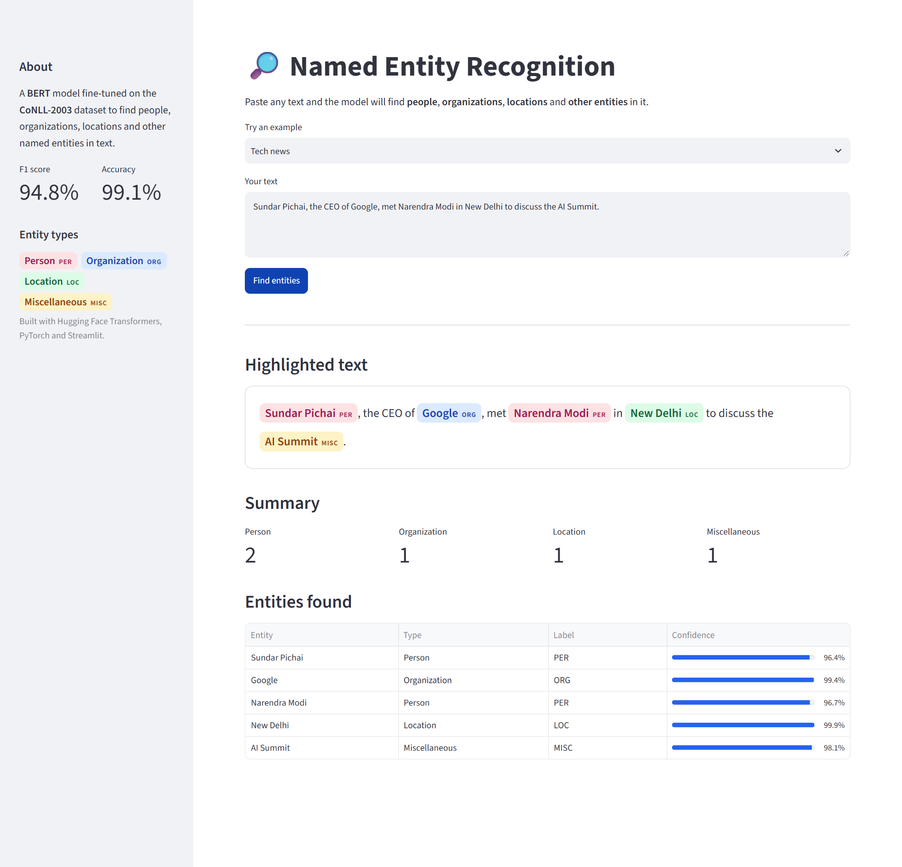

# BERT Named Entity Recognition API

A fine-tuned **BERT** model that finds **people, organizations, locations and other named entities** in plain text, served through a secure **Flask REST API**, a web form and a **Streamlit** demo.

```text
Input:  "John works at Google in New York."
Output: John → PER   ·   Google → ORG   ·   New York → LOC
```



<p align="center"><i>Streamlit demo: entities are highlighted inline, counted by type and listed with confidence scores.</i></p>

---

## The Problem

Most real-world text (news, emails, support tickets, contracts, resumes) is unstructured. Finding *who*, *which company* and *where* by hand is slow and doesn't scale. Keyword rules break as soon as a name is new or ambiguous: "Apple" can be a company or a fruit, and "Jordan" can be a person or a country.

**Named Entity Recognition (NER)** solves this by reading words in context and labeling them automatically. It's a core building block for search, document tagging, knowledge graphs and analytics pipelines.

## The Solution

1. **Train:** I fine-tuned `bert-base-cased` on the **CoNLL-2003** benchmark dataset so it tags each word as a Person, Organization, Location, Miscellaneous entity or nothing.
2. **Serve:** The trained model runs behind a Flask API, so any application can send text and get entities back as JSON.
3. **Harden:** The service has authentication, input validation, clear error codes, automated tests and Docker packaging, so it behaves like a production service and not just a notebook.

## Results

Evaluated on the CoNLL-2003 validation set (3,250 sentences) after 3 epochs:

| Metric    | Score     |
| --------- | --------- |
| **F1**    | **94.8%** |
| Precision | 94.7%     |
| Recall    | 94.9%     |
| Accuracy  | 99.1%     |

Precision, recall and F1 are entity-level scores computed with `seqeval`.

## Entity Types

| Label  | Meaning                         | Example                |
| ------ | ------------------------------- | ---------------------- |
| `PER`  | Person                          | *Elon Musk*            |
| `ORG`  | Organization                    | *Google*, *UN*         |
| `LOC`  | Location                        | *New York*, *India*    |
| `MISC` | Other (nationalities, events…)  | *Indian*, *World Cup*  |

## How It Works

```text
 Client (curl / app / browser)
            │  POST /api/predict  {"text": "..."}
            ▼
 ┌─────────────────────────────┐
 │  Flask + Waitress server    │  Basic Auth · input validation · error handling
 └─────────────┬───────────────┘
               ▼
 ┌─────────────────────────────┐
 │  NERService                 │  lazy model loading · 512-token limit check
 │  (Hugging Face pipeline)    │  thread-safe inference
 └─────────────┬───────────────┘
               ▼
       Fine-tuned BERT model  →  [{"word": "Google", "entity": "ORG"}, ...]
```

Sub-word tokens are merged back into whole words, so `New` + `York` comes back as one `New York` entity.

## Tech Stack

| Area        | Tools                                                     |
| ----------- | --------------------------------------------------------- |
| Model       | BERT (`bert-base-cased`), PyTorch, Hugging Face Transformers |
| Training    | Hugging Face `Trainer`, `datasets`, `seqeval`, CoNLL-2003 |
| API         | Flask, Flask-HTTPAuth, Waitress (WSGI server)             |
| UI          | HTML/Jinja templates, Streamlit                           |
| Quality     | pytest (unit and real-model integration tests)            |
| Deployment  | Docker                                                    |

## Engineering Highlights

- **No silent truncation:** BERT can read at most 512 tokens. Longer inputs are rejected with a clear message instead of quietly losing entities.
- **Secure by default:** Both prediction routes require login, and passwords are stored only as hashes in environment variables, never hard-coded.
- **Clear error handling:** The API returns `400` for bad input, `401` for failed login, `413` for an oversized body, `415` for the wrong content type and `503` when the model is missing, all as JSON.
- **Production-ready serving:** Waitress replaces Flask's debug server, the model loads once on first use, and a lock keeps inference thread-safe.
- **Tested:** Unit tests cover validation, auth, errors and HTML escaping. Integration tests run the real model, including Unicode text and the 512-token boundary.

---

## Quick Start

### 1. Install

```bash
git clone https://github.com/Karthikeyareddy183/BERT-based-Named-Entity-Recognition-API.git
cd BERT-based-Named-Entity-Recognition-API
python -m venv .venv
.venv\Scripts\activate          # macOS/Linux: source .venv/bin/activate
pip install -r requirements-dev.txt
```

The trained model files live in `ner-bert-model/`. The 430 MB weights file is stored with [Git LFS](https://git-lfs.com), so install it before cloning (or run `git lfs pull` afterwards). To use a different model folder, set `NER_MODEL_PATH`.

### 2. Set login credentials (PowerShell)

```powershell
$env:NER_USERNAME = 'admin'
$env:NER_PASSWORD_HASH = python -c "from getpass import getpass; from werkzeug.security import generate_password_hash; print(generate_password_hash(getpass('API password: ')))"
```

### 3. Run the API

```bash
waitress-serve --host=127.0.0.1 --port=5000 --threads=4 --call app:create_app
```

Open <http://127.0.0.1:5000/predict> for the web form, or call the API directly.

## API Usage

**Request**

```bash
curl -u admin -H "Content-Type: application/json" -d "{\"text\": \"John works at Google in New York.\"}" http://127.0.0.1:5000/api/predict
```

**Response**

```json
{
  "text": "John works at Google in New York.",
  "entities": [
    { "word": "John",     "entity": "PER" },
    { "word": "Google",   "entity": "ORG" },
    { "word": "New York", "entity": "LOC" }
  ]
}
```

| Endpoint       | Method     | Description                    |
| -------------- | ---------- | ------------------------------ |
| `/`            | GET        | Home page                      |
| `/predict`     | GET / POST | Web form (login required)      |
| `/api/predict` | POST       | JSON API (login required)      |

Input rules: `text` must be a non-empty string of up to 10,000 characters and 512 BERT tokens.

## Streamlit Demo

```bash
streamlit run "app(streamlit).py"
```

Opens at <http://localhost:8501>. The demo includes:

- **Example texts** (tech news, sports, business) to try with one click
- **Inline highlighting:** each entity is color-coded by type, directly in your text
- **Summary counts** of people, organizations, locations and other entities
- **Results table** with a confidence score for every entity

The Streamlit demo doesn't use login, so keep it local or put it behind access control.

## Docker

```bash
docker build -t ner-api .
docker run --rm -p 5000:5000 -e NER_USERNAME -e NER_PASSWORD_HASH ner-api
```

## Run Tests

```bash
python -m pytest -q
```

## Project Structure

```text
├── app.py                    # Flask app: routes, auth, error handling
├── ner_service.py            # Model loading, validation, inference
├── app(streamlit).py         # Streamlit demo UI
├── .streamlit/config.toml    # Streamlit theme and server settings
├── assets/                   # Screenshots for this README
├── ner.ipynb                 # Model training & evaluation notebook
├── ner-bert-model/           # Fine-tuned model weights + tokenizer
├── templates/                # HTML pages for the web form
├── test_app.py               # Unit tests (mocked model)
├── test_model_integration.py # Integration tests (real model)
├── Dockerfile
└── requirements*.txt
```

## Future Improvements

- Return confidence scores and character positions from the REST API (the Streamlit demo already shows them)
- Batch endpoint for processing many documents at once
- Token-based (JWT) auth and rate limiting
- GPU inference and ONNX export for lower latency
- Deploy to a cloud platform with CI/CD
